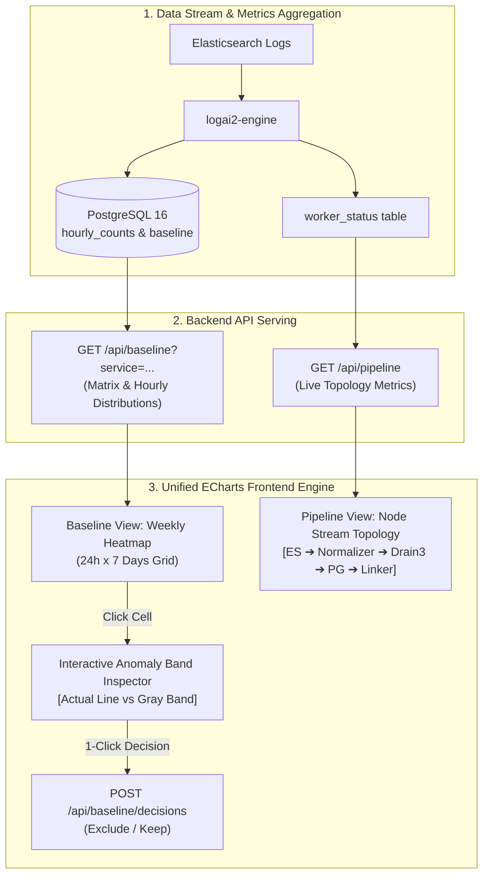

# Antigravity Proposal: Datadog Watchdog-Inspired Visual Observability, Interactive Baseline Heatmap, and Pipeline Flow Architecture

**Document ID:** AGY-PROP-2026-002  
**Author:** Antigravity (AI Tech Lead / Architecture Pair)  
**Target Repository:** `logai2`  
**Status:** ADOPTED, adapted (2026-10-21) as sub-project 9, [`per-service-baseline.md` section 9](per-service-baseline.md#9-operator-console-datadog-watchdog-style-sub-project-9); phases 1–2 detailed in spec [`2026-10-21-baseline-pipeline-pages.md`](../specs/2026-10-21-baseline-pipeline-pages.md). The design wins where they differ; the corrections are in [Review against the code](#review-against-the-code-2026-10-21). Not built.  
**Selected Strategy:** Strategy A — Unified Apache ECharts Visualization Engine  
**Related Documents:**
- [`docs/design/antigravity-proposed-additions.md`](antigravity-proposed-additions.md) (AGY-PROP-2026-001)
- [`docs/design/per-service-baseline.md`](per-service-baseline.md) (Source design)
- [`docs/WEB_UI.md`](../WEB_UI.md) (Current Web UI & HTTP API)
- [`ARCHITECTURE.md`](../../ARCHITECTURE.md) (Core System Architecture)

---

## Review against the code (2026-10-21)

Checked against `master` (`20f4ff6`). Nothing here is built. The user adopted
the redesign on 2026-10-21; design section 9 applies these corrections. Where this proposal and [`WEB_UI.md`](../WEB_UI.md) or
[`ARCHITECTURE.md`](../../ARCHITECTURE.md) disagree, those describe the code.

**Accurate today**

- Baseline page (§1.1): cards, then Suggestions, Add a range (day / from /
  to `<select>`s), Decisions and Days tables, plus Recompute.
- Pipeline page (§1.1): scalar cards and a sparkline of the last 60
  heartbeats kept only in the browser tab.
- `POST /api/baseline/decisions` body (§5.3 Pillar 3) matches the API;
  `hour_to` is exclusive, `0 <= hour_from < hour_to <= 24`.
- `[TRAFFIC DROP]` matches detection: `*total` raises only drops, only on a
  full profile with mean >= `drop.min_mean` (20).
- Theme tokens are in `static/css/tokens.css` with `html[data-theme]`; no
  vendor directory exists yet.

**Out of date or wrong**

1. **Templates page (Pillar 2).** Redesigned since this was written
   (`be5d7ee`, spec `2026-10-21-templates-page-redesign.md`): five columns,
   a To review | All templates mode, and the **rate** column already shows
   the hour's rate against the band (`normal <= X/min`, "▲ above normal").
   The user ruled no charts on Templates. A delta would be a third line in
   that column, not a new column. `GET /api/templates` returns `rate`,
   `band_low`, `band_high` but not `mean`.
2. **Δ% with mean 0.** `(rate - mean) / mean` is undefined for new
   templates and for the hours a service is idle (mean = σ = 0, ARCHITECTURE
   §14). Needs a rule (e.g. show "new" / "no baseline", or use the existing
   `score = count / band_high`).
3. **`[VOLUME SURGE]`** "breaches mean + 3σ by >= +200%" mixes two
   references (band and mean). Detection already stores `score =
   count / band_high` per key in `alert_state`; a threshold on it is
   unambiguous.
4. **`[NEW ERROR PATTERN]`** needs `first_seen` on alert rows;
   `GET /api/alerts` does not return it (only `/api/templates` does).
5. **Pipeline topology (§5.2, §6.2).** The order is wrong: detection runs in
   the engine on each closed minute, **before** the flush, and Prometheus is
   exported by the engine; the linker talks to the engine only through
   Postgres (`reload_links` command). `worker_status` has no
   `flush_duration_ms` (only the Prometheus gauge `logai_flush_seconds`),
   template count, oldest open minute or active LLM profile: §6.2 needs
   engine and linker changes, not only `app.py`. LLM profiles fail over
   (every active profile, by priority), so "active profile" is a list.
6. **Exclusion timing (Pillar 3, §5.1).** Decisions take effect at the next
   daily commit **or** a Recompute (`POST /api/baseline/recompute`). An
   incident that crosses local midnight needs one decision per day.
7. **"1 click commits" (§2 principle 4, §5.1).** Today's review keeps unreviewed hours
   in the baseline and warns when an exclusion leaves fewer than 3 usable
   days; a one-click exclude must keep that warning.
8. **ECharts size (§3.1).** The full `echarts.min.js` 5.x build is about
   1 MB minified; the stated ~450 KB needs a custom build. Confirm before
   vendoring.
9. **Branch (footer).** `embeddings-doc-links` was merged into `master`
   (`236c2bb`); new work starts from `master`.

**Schema claim (§2.2).** Holds for §5.1 and Pillars 1–3 (hourly counts,
baseline, alert state and changes exist). Per-minute history for the
inspector line exists only in `alert_minutes`, and only for minutes a key was
not NORMAL; a full minute-by-minute line for normal minutes is not stored.

---

## 1. Executive Summary & Problem Statement

### 1.1 The Current Problem: Visual Disconnect and Operator Friction
`logai2` successfully replaced the brittle Isolation Forest and unmaintained state-file architecture of `logai-engine` with a robust, deterministic statistical model: **Drain3 per-service** + **Mean ± kσ baseline** + **Layered runbook matching (bge-m3 + LLM)**.

However, the operator-facing console ([`logai2/web/`](../../logai2/web/app.py)) presents critical telemetry through fragmented, tabular, and disconnected representations:
1. **The Baseline Review Chaos (`/#baseline`):**
   - The current baseline review page renders 4 disconnected text tables (*"Suggested periods"*, *"Add range"*, *"Decisions"*, *"Committed days"*).
   - Operators reviewing an alert suggested between `02:00–04:00` are given **zero visual context**: they cannot see the actual count spike, the historical band width, or whether the peak was a sharp 1-minute burst or sustained saturation.
   - Adding a maintenance or incident window requires manually selecting hours in sequential `<select>` dropdowns (`From: 01:00`, `To: 02:00`), reminiscent of legacy forms from two decades ago.
2. **The Pipeline Blindspot (`/#pipeline`):**
   - Ingestion and pipeline performance is presented as a list of independent scalar cards and an ephemeral 60-sample SVG sparkline.
   - Operators cannot visualize where data is backlogged or bottlenecked across the multi-stage architecture (`Elasticsearch` $\to$ `KnownLines Cache` $\to$ `Drain3 Miners` $\to$ `Postgres Flush Transaction` $\to$ `Linker Embedder` $\to$ `Prometheus Exporter`).
3. **Missing Watchdog High-Fidelity Insights (`/#alerting` & `/#templates`):**
   - The system computes standard deviations and historical rates, but lacks Datadog Watchdog's key signature features: **Expected Anomaly Bands** (shaded confidence intervals), **Volume Delta Percentage** (`+450% vs 24h avg`), and **New Pattern Discovery tags**.

### 1.2 The Proposed Solution: Strategy A (Unified Apache ECharts)
Adopt the visual paradigms of **Datadog Watchdog for Logs** and **Datadog Observability Pipelines** using **Apache ECharts** as a single, self-hosted, lightweight visualization engine:
- **Baseline Matrix & Visual Band Inspector:** Replace the chaotic tables with an intuitive **24-hour $\times$ 7-day Weekly Calendar Heatmap**. Clicking any hour opens an interactive **Datadog-style Anomaly Band chart** (actual metric line vs. shaded `mean ± kσ` gray band), with 1-click `[Exclude from Baseline]` or `[Keep in Baseline]`.
- **Pipeline Data Stream Topology:** Transform the Pipeline page into a live **Directed Acyclic Graph (DAG) Topology Flow**, visualizing throughput (ev/s), lag (seconds), cache efficiency, and health status per stage in real time.
- **Watchdog Anomaly Tags & Pattern Delta:** Surface contextual tags (`[NEW PATTERN]`, `[VOLUME SURGE]`, `[TRAFFIC DROP]`) and percentage surges directly in the Alerting and Templates views.

---

## 2. Core Architectural & Design Principles

```
┌────────────────────────────────────────────────────────────────────────┐
│                   ANTIGRAVITY VISUAL INTEGRITY PRINCIPLES              │
├────────────────────────────────────────────────────────────────────────┤
│ 1. Zero Build-Step & Offline Self-Hosting                              │
│    No Node.js, Webpack, or NPM runtime. Apache ECharts is self-hosted  │
│    as a single minified bundle in /static/vendor/echarts.min.js.       │
│                                                                        │
│ 2. Zero Database Schema Alteration                                     │
│    The existing Postgres schema (service_hours, hourly_counts,         │
│    baseline, alert_changes, worker_status) already stores 100% of the  │
│    required historical and real-time telemetry.                        │
│                                                                        │
│ 3. Native Dark/Light Theme Reactivity                                  │
│    Visual charts automatically listen to data-theme="dark|light" and   │
│    apply logai2's design tokens (tokens.css) seamlessly.               │
│                                                                        │
│ 4. Single-Click Human Decision Loop                                    │
│    Review decisions must not require form entry: 1 click on the cell   │
│    or graph immediately commits the exclusion or retention.            │
└────────────────────────────────────────────────────────────────────────┘
```

---

## 3. Technology Decision: Strategy A (Unified Apache ECharts Engine)

### 3.1 Why Apache ECharts Over Disjointed Micro-Libraries?
While a hybrid approach (`uPlot` + custom SVG + CSS Grid) has a smaller footprint, **Strategy A (Apache ECharts)** is selected for the following decisive architectural advantages:

| Requirement | Apache ECharts Capability | Benefit to `logai2` |
|---|---|---|
| **Anomaly Band Charting** | Stacked Area Series (`stack: 'confidence-band'`) with dynamic color thresholds and markPoint outliers | Generates exact replica of Datadog's gray expected band and red anomaly highlights. |
| **Pipeline Stream Topology** | Native `type: 'graph'` with directed links, node badges, and particle flow animations | Renders interactive pipeline stages with real-time throughput metrics. |
| **24x7 Calendar Heatmap** | Native `type: 'heatmap'` with visual continuous/piecewise scale | Directly models 24 hours $\times$ 7 days with zero custom layout math. |
| **Theme & Memory Management** | Built-in dark/light palette, automatic Canvas instance disposal on hash route transitions | Avoids memory leaks during 24/7 wall-monitor operations. |
| **Asset Footprint** | Single file `echarts.min.js` (~450 KB gzip ~140 KB) served locally from Flask | Conforms strictly to local-only, air-gapped deployment rules. |

---

## 4. End-to-End Visual Workflow & User Experience



---

## 5. Detailed UI/UX Specifications

---

### 5.1 The Baseline Matrix & Visual Band Inspector (`/#baseline`)

The existing 4 tabular sections are replaced with a two-tier interactive workstation:

#### Tier 1: Weekly Baseline Health Matrix (24 Hours $\times$ 7 Committed Days)
A structured heatmap grid rendered directly via ECharts or responsive cell tokens:
- **Rows:** The last committed days (ordered Mon $\to$ Sun, split by weekday and weekend profiles).
- **Columns:** 24 hours of the day (`00:00` $\to$ `23:00`).
- **Cell States:**
  - 🟩 **Clean (Green):** Normal operations, counts comfortably inside `mean ± 3σ`.
  - 🔥 **Spike / Review Needed (Amber/Red):** Period suggested by the engine for review (key entered `WARMING`/`ALERTING`).
  - 🚫 **Excluded (Hatched Gray/Red):** Operator has marked this hour as a real incident; stripped from baseline calculation.
  - ⬜ **Silent / Zero (Muted):** Replayer or service was inactive; counts are 0.

#### Tier 2: Interactive Anomaly Band Inspector (Slide-down Panel)
Clicking any cell in the 24x7 matrix opens the Inspector Panel for that specific hour:

```
┌────────────────────────────────────────────────────────────────────────────────────────┐
│ 🔍 INSPECTOR: Tue 2026-10-20 | 02:00 – 03:00 | Service: recharge                      │
│ Status: 🔥 Suggested Exclude (2 Templates breached upper threshold)                     │
├────────────────────────────────────────────────────────────────────────────────────────┤
│                                                                                        │
│   Events/min                                                                           │
│      ▲                                                                                 │
│  200 ┤                                           ╭─────╮   <-- Actual Log Rate         │
│  150 ┤                                          ╭╯     ╰╮                              │
│  120 ┤.........................................╭╯.......╰╮............................ │
│      │ ░░░░░░░░░░░░░░░░░░░░░░░░░░░░░░░░░░░░░░░░█░░░░░░░░░█░░░░░░░ <-- Upper Band (mean+3σ)  │
│   60 ┤ ░░░░░░░░░░░░░░░░░░░░░░░░░░░░░░░░░░░░░░░░░░░░░░░░░░░░░░░ <-- Expected Normal Range │
│   30 ┤ ░░░░░░░░░░░░░░░░░░░░░░░░░░░░░░░░░░░░░░░░░░░░░░░░░░░░░░░ <-- Lower Band (mean-3σ)  │
│    0 ┼───────────────────────────────────────────────────►                             │
│     02:00      02:15      02:30      02:45      03:00                                  │
│                                                                                        │
│   Contributing Templates in this Window:                                               │
│   • recharge:T00032 [ERROR] LixiHandler timeout (Peak: 175/min | Band: 42.5/min)       │
│   • recharge:T00042 [WARN] DB connection pool slow (Peak: 38/min | Band: 12.0/min)     │
│                                                                                        │
├────────────────────────────────────────────────────────────────────────────────────────┤
│ Operator Decision:                                                                     │
│   [ 🚫 Exclude from Baseline (Real Incident) ]   [ 🟩 Keep in Baseline (Normal Traffic) ]│
└────────────────────────────────────────────────────────────────────────────────────────┘
```

**Operator Advantages:**
- Eradicates guesswork: operators immediately see the peak vs. the expected band.
- No form inputs: 1 click on the decision button immediately triggers `POST /api/baseline/decisions` and updates the cell status.

---

### 5.2 The Pipeline Data Stream Topology (`/#pipeline`)

The Pipeline page is overhauled into a Datadog Observability Pipeline-style topology:

```
 ┌─────────────────┐       ┌──────────────────────┐       ┌────────────────────────┐
 │  ELASTICSEARCH  │ ────► │ INGEST & NORMALIZER  │ ────► │  DRAIN3 MINER ENGINE   │
 │ recharge-logs   │       │ LRU Cache Hit: 99.6% │       │ 308 Templates Known    │
 │ Lag: 30.0s      │       │ Events: 20,450/s     │       │ Miss Rate: 0.4%        │
 └─────────────────┘       └──────────────────────┘       └────────────────────────┘
                                                                       │
                                                                       ▼
 ┌─────────────────┐       ┌──────────────────────┐       ┌────────────────────────┐
 │   PROMETHEUS    │ ◄──── │  DETECTION ENGINE    │ ◄──── │  POSTGRES STORAGE TX   │
 │ Port: 9108      │       │ Detection: ON        │       │ Flush Latency: 14ms    │
 │ Active Alerts: 2│       │ Hysteresis: Normal   │       │ Cursor: Oldest Open Min│
 └─────────────────┘       └──────────────────────┘       └────────────────────────┘
                                      ▲
                                      │
                           ┌──────────────────────┐
                           │   LINKER & LLM POOL  │
                           │ bge-m3: Connected    │
                           │ Active LLM: DeepSeek │
                           └──────────────────────┘
```

**Key Interactive Elements:**
- **Dynamic Node Health:** Nodes pulse Green (Healthy), Amber (Degraded/High Lag/High Miss Rate), or Red (Stalled/Unreachable).
- **Edge Particle Stream:** Moving animated particles show log flow velocity proportional to incoming `events_per_second`.
- **Node Drilldown Drawer:** Clicking any node reveals sub-system health (e.g., clicking *Drain3 Miner* reveals cluster size distributions; clicking *Postgres* reveals partition count and commit latency).

---

### 5.3 Datadog Watchdog Insights on Alerting & Templates (Phase 3 Deep Dive)

Phase 3 elevates `logai2` from a raw mathematical threshold checker into an **intelligent operational assistant**, replicating Datadog Watchdog's signature root cause analysis, automated triage, and baseline protection workflows. It is built upon **three foundational pillars**:

```
┌────────────────────────────────────────────────────────────────────────────────────────┐
│                        PHASE 3: WATCHDOG INTELLIGENCE PILLARS                          │
├────────────────────────────────────────────────────────────────────────────────────────┤
│ 1. Watchdog Insights Banner & Outlier Classification                                  │
│    • Real-time contextual banner at the top of /#alerting.                             │
│    • Automated classification: [NEW ERROR PATTERN], [VOLUME SURGE], [TRAFFIC DROP].   │
│                                                                                        │
│ 2. Log Pattern Volume Delta (% Change vs. Baseline)                                    │
│    • Relative deviation Δ% = (Rate_current - Mean_baseline) / Mean_baseline * 100%.    │
│    • Early-warning indicator on /#templates before 3-minute hysteresis triggers.       │
│                                                                                        │
│ 3. 1-Click Incident Marking & Baseline Exclusion Loop                                  │
│    • Closes the feedback loop between Incident Response and Baseline Purity.           │
│    • 1-click action directly on Alert Cards to exclude burst hours from next commit.   │
└────────────────────────────────────────────────────────────────────────────────────────┘
```

#### Pillar 1: Watchdog Insights Banner & Outlier Classification
Rather than forcing on-call SREs to parse through raw lists of alert rows, an **Insights Header** continuously synthesizes the macro state:

```
┌────────────────────────────────────────────────────────────────────────────────────────┐
│ 💡 WATCHDOG INSIGHTS (Active Triage)                                                   │
│ Detected 2 critical anomalies in service [recharge] over the last 15 minutes:          │
│ • 🏷️ [NEW ERROR PATTERN] Novel signature first seen 12m ago (180/min on API Topup).    │
│ • 🏷️ [VOLUME SURGE] Known DB pool timeout spiked +450% above baseline.                 │
└────────────────────────────────────────────────────────────────────────────────────────┘
```

**Automated Tagging Engine (Powered by Existing Postgres State):**
Every active alert card is labeled with an unambiguous classification tag:

1. 🏷️ **`[NEW ERROR PATTERN]` (Brand-New Signature):**
   - **Condition:** Template has `templates.first_seen > now() - interval '24 hours'`, has no committed baseline profile in previous days, and level is `ERROR`, `FATAL`, or `CRITICAL`.
   - **Operational Significance:** 90% correlation with **new code deployments, unannounced schema changes, or third-party partner API breaking changes**. Alerts SREs immediately to check recent deployment changelogs.
2. 🏷️ **`[VOLUME SURGE]` (Rate Explosion in Known Pattern):**
   - **Condition:** Template is established in baseline, but the current minute rate breaches `Mean + 3σ` by a relative surge $\ge +200\%$.
   - **Operational Significance:** Points to **resource saturation, lock contention, cascading retries, or traffic floods**.
3. 🏷️ **`[TRAFFIC DROP]` (Silent Failure / Outage):**
   - **Condition:** Service key `*total` drops below `Mean - 3σ` (where `Mean >= 20.0` events/min).
   - **Operational Significance:** Points to **upstream gateway outage, DNS failure, or network partition** where client traffic ceases to arrive ("the silence of failure").

---

#### Pillar 2: Log Pattern Volume Delta (% Change vs. Baseline)
On the Templates management page ([`/#templates`](../../logai2/web/static/js/views/templates.js)), static numbers (`150/min`) fail to convey relative danger. Phase 3 introduces **Dynamic Volume Deltas**:

$$\Delta\% = \frac{\text{Rate}_{\text{actual}} - \text{Mean}_{\text{baseline}}}{\text{Mean}_{\text{baseline}}} \times 100\%$$

```
Template Text                                     Current Rate        Volume Delta (% vs Baseline)
──────────────────────────────────────────────────────────────────────────────────────────────────
[recharge:T00032] LixiHandler timeout error ...   175.0/min           🔴 +385% (Surging)
[recharge:T00042] DB connection pool slow ...      62.0/min           🟠 +140% (Elevated)
[recharge:T00001] Success transaction processed 2,420.0/min           🟢   +2% (Normal)
[recharge:T00015] Kafka consumer heartbeat         11.0/min           🔵  -48% (Depressed)
```

**Visual Hierarchy & Early Warning:**
- **Crimson Badge ($\ge +200\%$):** Severe surge.
- **Amber Badge ($+50\%$ to $+200\%$):** Elevated activity.
- **Muted Green ($-20\%$ to $+50\%$):** Healthy nominal variance.
- **Blue Badge ($\le -40\%$):** Significant traffic drop.
- **SRE Advantage:** Operators can identify an impending incident **minutes before** the strict 3-minute hysteresis threshold fires an alert.

---

#### Pillar 3: 1-Click Incident Marking & Baseline Exclusion Loop
A primary flaw of self-learning baseline systems is **Baseline Poisoning**: if an incident lasts 30 minutes and is not manually excluded, the daily commit at 02:00 calculates the burst into the baseline, turning outage volume into the "new normal".

**The 1-Click Closed Loop:**
Phase 3 embeds an actionable button directly on active or recovering Alert cards (`ALERTING`, `COOLING`, or recently recovered `NORMAL`):

```
┌────────────────────────────────────────────────────────────────────────────────────────┐
│ [ALERTING] recharge · DOC-001 (VNPay Topup Timeout)                     Since 02:14:00 │
│ • recharge:T00032 [ERROR] LixiHandler timeout ... (175/min vs Band: 42.5/min)          │
├────────────────────────────────────────────────────────────────────────────────────────┤
│ [ 🚫 Mark Incident & Exclude from Baseline ]                   [ 📖 View Runbook ]     │
└────────────────────────────────────────────────────────────────────────────────────────┘
```

**Execution Flow:**
1. SRE clicks **`[ 🚫 Mark Incident & Exclude from Baseline ]`**.
2. The frontend extracts the incident's active time boundary (`since` $\to$ `now`), widens to whole local hours (`hour_from`, `hour_to`), and dispatches:
   ```http
   POST /api/baseline/decisions
   {"service": "recharge", "day": "2026-10-20", "hour_from": 2, "hour_to": 3, "decision": "exclude"}
   ```
3. The button instantly morphs into a confirmed status badge:
   `[ ✅ Excluded from Baseline (Hours 02:00–03:00) ]`.
4. The exclusion takes effect at the next nightly commit, ensuring the incident volume is stripped from historical calculations without requiring the operator to switch tabs or remember timestamps.

---

## 6. Backend & API Contract Extensions

All frontend enhancements are supported by non-breaking, backward-compatible extensions to `logai2/web/app.py`:

### 6.1 Extended Baseline Endpoint (`GET /api/baseline?service=...`)
Extend the response JSON to deliver hourly statistical distribution data for the matrix and inspector:

```json
{
  "days": [
    {"day": "2026-10-20", "daytype": "weekday", "committed": true}
  ],
  "matrix": [
    {
      "day": "2026-10-20",
      "hour": 2,
      "status": "suggested",
      "alert_keys": ["recharge:T00032"],
      "total_events": 8500,
      "mean": 42.5,
      "std": 8.2,
      "band_high": 67.1,
      "band_low": 17.9,
      "decision": null
    }
  ],
  "suggestions": [...],
  "decisions": [...]
}
```

### 6.2 Extended Pipeline Topology Endpoint (`GET /api/pipeline`)
`app.py` computes stage metrics from `worker_status['engine']` and `worker_status['linker']`:

```json
{
  "topology": {
    "ingest": {"status": "healthy", "lag_seconds": 30.0, "events_per_second": 20450},
    "cache": {"status": "healthy", "hit_ratio": 0.996, "miss_ratio": 0.004},
    "miners": {"status": "healthy", "template_count": 308},
    "storage": {"status": "healthy", "flush_duration_ms": 14.2, "oldest_open_minute": 29876540},
    "linker": {"status": "healthy", "pending_templates": 0, "pending_docs": 0, "active_profile": "gemini"}
  }
}
```

### 6.3 Extended Alerts & Templates Endpoints for Watchdog Insights
1. **`GET /api/alerts`:**
   Each row in the returned list receives automated classification attributes:
   ```json
   {
     "service": "recharge",
     "kind": "document",
     "doc_id": "DOC-001",
     "state": "ALERTING",
     "since": 1792462440,
     "watchdog": {
       "anomaly_type": "volume_surge",
       "delta_percent": 385.2,
       "first_seen": 1792400000,
       "burst_window": {"day": "2026-10-20", "hour_from": 2, "hour_to": 3}
     }
   }
   ```
2. **`GET /api/templates`:**
   Each template item includes `delta_percent` computed directly from `(rate - mean) / mean * 100`:
   ```json
   {
     "template_id": "recharge:T00032",
     "rate": 175.0,
     "mean": 36.0,
     "delta_percent": 386.1,
     "band_high": 65.0
   }
   ```

---

## 7. Performance, Memory & Zero-Build Integrity

1. **Vendor Asset Placement:**
   - Single vendor bundle: `logai2/web/static/vendor/echarts.min.js`.
   - Direct inclusion in `index.html`:
     ```html
     <script src="/static/vendor/echarts.min.js"></script>
     ```
   - Zero external CDN dependencies; remains 100% operational in isolated telecom air-gapped environments.
2. **DOM Lifecycle & Memory Protection:**
   - Standardize ECharts instance cleanup on view transitions:
     ```javascript
     if (currentChart) {
       currentChart.dispose();
       currentChart = null;
     }
     ```
   - Prevents Canvas memory inflation during prolonged operations room monitoring.

---

## 8. Strategic Implementation Roadmap

| Phase | Milestone | Key Deliverables & Acceptance Criteria |
| :--- | :--- | :--- |
| **Phase 1: Baseline Overhaul** | Visual Review & Anomaly Band | 1. Vendor ECharts in `static/vendor/echarts.min.js`.<br/>2. Implement 24x7 Heatmap Grid in `baseline.js` (rows = committed days, cols = 0–23h).<br/>3. Implement Anomaly Band Inspector (actual line vs shaded `mean ± 3σ` band) with 1-click Exclude/Keep.<br/>*Criteria:* Full removal of legacy 4 text tables and sequential hour select form. |
| **Phase 2: Pipeline Topology** | Observability Stream DAG | 1. Implement DAG node layout in `pipeline.js` representing 5 pipeline stages.<br/>2. Connect live lag, throughput, and flush latency to topology nodes with reactive health status.<br/>3. Add animated particle flow for live traffic.<br/>*Criteria:* Visual identification of pipeline bottlenecks at a glance. |
| **Phase 3: Watchdog Intelligence** | Pattern Deltas & Insights | 1. **Insights Banner on Alerting:** Real-time synthesis of macro anomalies, distinguishing `[NEW ERROR PATTERN]`, `[VOLUME SURGE]`, and `[TRAFFIC DROP]`.<br/>2. **Volume Delta (%) on Templates:** Compute relative surge $\Delta\%$ vs. baseline mean; highlight deviations $\ge +200\%$ in crimson.<br/>3. **1-Click Baseline Exclusion Loop:** Direct action on Alert Cards to exclude burst hours from next commit, completely eliminating baseline poisoning.<br/>*Criteria:* Zero tab-switching required to protect baseline during live incidents. |

---

*Authored by Antigravity — submitted for architectural adoption on branch `embeddings-doc-links` (since merged into `master`).*
