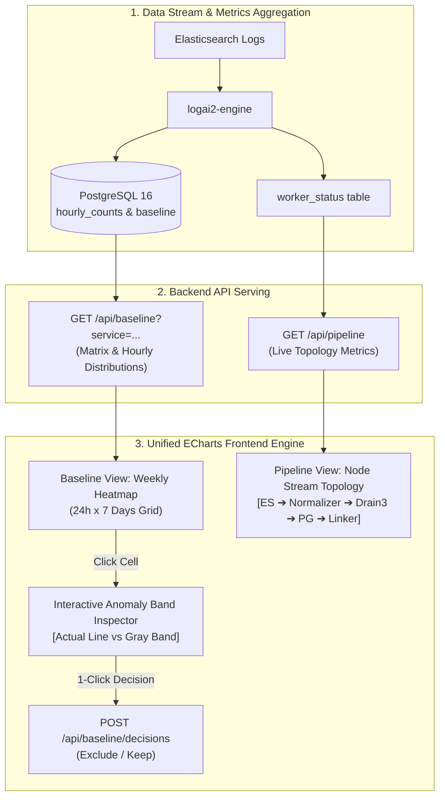

# Antigravity Proposal: Datadog Watchdog-Inspired Visual Observability, Interactive Baseline Heatmap, and Pipeline Flow Architecture

**Document ID:** AGY-PROP-2026-002  
**Author:** Antigravity (AI Tech Lead / Architecture Pair)  
**Target Repository:** `logai2`  
**Status:** PROPOSED (2026-10-21)  
**Selected Strategy:** Strategy A — Unified Apache ECharts Visualization Engine  
**Related Documents:**
- [`docs/design/antigravity-proposed-additions.md`](file:///home/cong/Documents/logai2/docs/design/antigravity-proposed-additions.md) (AGY-PROP-2026-001)
- [`docs/design/per-service-baseline.md`](file:///home/cong/Documents/logai2/docs/design/per-service-baseline.md) (Source design)
- [`docs/WEB_UI.md`](file:///home/cong/Documents/logai2/docs/WEB_UI.md) (Current Web UI & HTTP API)
- [`ARCHITECTURE.md`](file:///home/cong/Documents/logai2/ARCHITECTURE.md) (Core System Architecture)

---

## 1. Executive Summary & Problem Statement

### 1.1 The Current Problem: Visual Disconnect and Operator Friction
`logai2` successfully replaced the brittle Isolation Forest and unmaintained state-file architecture of `logai-engine` with a robust, deterministic statistical model: **Drain3 per-service** + **Mean ± kσ baseline** + **Layered runbook matching (bge-m3 + LLM)**.

However, the operator-facing console ([`logai2/web/`](file:///home/cong/Documents/logai2/logai2/web/app.py)) presents critical telemetry through fragmented, tabular, and disconnected representations:
1. **The Baseline Review Chaos (`/#baseline`):**
   - The current baseline review page renders 4 disconnected text tables (*"Suggested periods"*, *"Add range"*, *"Decisions"*, *"Committed days"*).
   - Operators reviewing an alert suggested between `02:00–04:00` are given **zero visual context**: they cannot see the actual count spike, the historical band width, or whether the peak was a sharp 1-minute burst or sustained saturation.
   - Adding a maintenance or incident window requires manually selecting hours in sequential `<select>` dropdowns (`From: 01:00`, `To: 02:00`), reminiscent of legacy forms from two decades ago.
2. **The Pipeline Blindspot (`/#pipeline`):**
   - Ingestion and pipeline performance is presented as a list of independent scalar cards and an ephemeral 60-sample SVG sparkline.
   - Operators cannot visualize where data is backlogged or bottlenecked across the multi-stage architecture (`Elasticsearch` $\to$ `KnownLines Cache` $\to$ `Drain3 Miners` $\to$ `Postgres Flush Transaction` $\to$ `Linker Embedder` $\to$ `Prometheus Exporter`).
3. **Missing Watchdog High-Fidelity Insights (`/#alerting` & `/#templates`):**
   - The system computes standard deviations and historical rates, but lacks Datadog Watchdog's key signature features: **Expected Anomaly Bands** (shaded confidence intervals), **Volume Delta Percentage** (`+450% vs 24h avg`), and **New Pattern Discovery tags**.

### 1.2 The Proposed Solution: Strategy A (Unified Apache ECharts)
Adopt the visual paradigms of **Datadog Watchdog for Logs** and **Datadog Observability Pipelines** using **Apache ECharts** as a single, self-hosted, lightweight visualization engine:
- **Baseline Matrix & Visual Band Inspector:** Replace the chaotic tables with an intuitive **24-hour $\times$ 7-day Weekly Calendar Heatmap**. Clicking any hour opens an interactive **Datadog-style Anomaly Band chart** (actual metric line vs. shaded `mean ± kσ` gray band), with 1-click `[Exclude from Baseline]` or `[Keep in Baseline]`.
- **Pipeline Data Stream Topology:** Transform the Pipeline page into a live **Directed Acyclic Graph (DAG) Topology Flow**, visualizing throughput (ev/s), lag (seconds), cache efficiency, and health status per stage in real time.
- **Watchdog Anomaly Tags & Pattern Delta:** Surface contextual tags (`[NEW PATTERN]`, `[VOLUME SURGE]`, `[TRAFFIC DROP]`) and percentage surges directly in the Alerting and Templates views.

---

## 2. Core Architectural & Design Principles

```
┌────────────────────────────────────────────────────────────────────────┐
│                   ANTIGRAVITY VISUAL INTEGRITY PRINCIPLES              │
├────────────────────────────────────────────────────────────────────────┤
│ 1. Zero Build-Step & Offline Self-Hosting                              │
│    No Node.js, Webpack, or NPM runtime. Apache ECharts is self-hosted  │
│    as a single minified bundle in /static/vendor/echarts.min.js.       │
│                                                                        │
│ 2. Zero Database Schema Alteration                                     │
│    The existing Postgres schema (service_hours, hourly_counts,         │
│    baseline, alert_changes, worker_status) already stores 100% of the  │
│    required historical and real-time telemetry.                        │
│                                                                        │
│ 3. Native Dark/Light Theme Reactivity                                  │
│    Visual charts automatically listen to data-theme="dark|light" and   │
│    apply logai2's design tokens (tokens.css) seamlessly.               │
│                                                                        │
│ 4. Single-Click Human Decision Loop                                    │
│    Review decisions must not require form entry: 1 click on the cell   │
│    or graph immediately commits the exclusion or retention.            │
└────────────────────────────────────────────────────────────────────────┘
```

---

## 3. Technology Decision: Strategy A (Unified Apache ECharts Engine)

### 3.1 Why Apache ECharts Over Disjointed Micro-Libraries?
While a hybrid approach (`uPlot` + custom SVG + CSS Grid) has a smaller footprint, **Strategy A (Apache ECharts)** is selected for the following decisive architectural advantages:

| Requirement | Apache ECharts Capability | Benefit to `logai2` |
|---|---|---|
| **Anomaly Band Charting** | Stacked Area Series (`stack: 'confidence-band'`) with dynamic color thresholds and markPoint outliers | Generates exact replica of Datadog's gray expected band and red anomaly highlights. |
| **Pipeline Stream Topology** | Native `type: 'graph'` with directed links, node badges, and particle flow animations | Renders interactive pipeline stages with real-time throughput metrics. |
| **24x7 Calendar Heatmap** | Native `type: 'heatmap'` with visual continuous/piecewise scale | Directly models 24 hours $\times$ 7 days with zero custom layout math. |
| **Theme & Memory Management** | Built-in dark/light palette, automatic Canvas instance disposal on hash route transitions | Avoids memory leaks during 24/7 wall-monitor operations. |
| **Asset Footprint** | Single file `echarts.min.js` (~450 KB gzip ~140 KB) served locally from Flask | Conforms strictly to local-only, air-gapped deployment rules. |

---

## 4. End-to-End Visual Workflow & User Experience



---

## 5. Detailed UI/UX Specifications

---

### 5.1 The Baseline Matrix & Visual Band Inspector (`/#baseline`)

The existing 4 tabular sections are replaced with a two-tier interactive workstation:

#### Tier 1: Weekly Baseline Health Matrix (24 Hours $\times$ 7 Committed Days)
A structured heatmap grid rendered directly via ECharts or responsive cell tokens:
- **Rows:** The last committed days (ordered Mon $\to$ Sun, split by weekday and weekend profiles).
- **Columns:** 24 hours of the day (`00:00` $\to$ `23:00`).
- **Cell States:**
  - 🟩 **Clean (Green):** Normal operations, counts comfortably inside `mean ± 3σ`.
  - 🔥 **Spike / Review Needed (Amber/Red):** Period suggested by the engine for review (key entered `WARMING`/`ALERTING`).
  - 🚫 **Excluded (Hatched Gray/Red):** Operator has marked this hour as a real incident; stripped from baseline calculation.
  - ⬜ **Silent / Zero (Muted):** Replayer or service was inactive; counts are 0.

#### Tier 2: Interactive Anomaly Band Inspector (Slide-down Panel)
Clicking any cell in the 24x7 matrix opens the Inspector Panel for that specific hour:

```
┌────────────────────────────────────────────────────────────────────────────────────────┐
│ 🔍 INSPECTOR: Tue 2026-10-20 | 02:00 – 03:00 | Service: recharge                      │
│ Status: 🔥 Suggested Exclude (2 Templates breached upper threshold)                     │
├────────────────────────────────────────────────────────────────────────────────────────┤
│                                                                                        │
│   Events/min                                                                           │
│      ▲                                                                                 │
│  200 ┤                                           ╭─────╮   <-- Actual Log Rate         │
│  150 ┤                                          ╭╯     ╰╮                              │
│  120 ┤.........................................╭╯.......╰╮............................ │
│      │ ░░░░░░░░░░░░░░░░░░░░░░░░░░░░░░░░░░░░░░░░█░░░░░░░░░█░░░░░░░ <-- Upper Band (mean+3σ)  │
│   60 ┤ ░░░░░░░░░░░░░░░░░░░░░░░░░░░░░░░░░░░░░░░░░░░░░░░░░░░░░░░ <-- Expected Normal Range │
│   30 ┤ ░░░░░░░░░░░░░░░░░░░░░░░░░░░░░░░░░░░░░░░░░░░░░░░░░░░░░░░ <-- Lower Band (mean-3σ)  │
│    0 ┼───────────────────────────────────────────────────►                             │
│     02:00      02:15      02:30      02:45      03:00                                  │
│                                                                                        │
│   Contributing Templates in this Window:                                               │
│   • recharge:T00032 [ERROR] LixiHandler timeout (Peak: 175/min | Band: 42.5/min)       │
│   • recharge:T00042 [WARN] DB connection pool slow (Peak: 38/min | Band: 12.0/min)     │
│                                                                                        │
├────────────────────────────────────────────────────────────────────────────────────────┤
│ Operator Decision:                                                                     │
│   [ 🚫 Exclude from Baseline (Real Incident) ]   [ 🟩 Keep in Baseline (Normal Traffic) ]│
└────────────────────────────────────────────────────────────────────────────────────────┘
```

**Operator Advantages:**
- Eradicates guesswork: operators immediately see the peak vs. the expected band.
- No form inputs: 1 click on the decision button immediately triggers `POST /api/baseline/decisions` and updates the cell status.

---

### 5.2 The Pipeline Data Stream Topology (`/#pipeline`)

The Pipeline page is overhauled into a Datadog Observability Pipeline-style topology:

```
 ┌─────────────────┐       ┌──────────────────────┐       ┌────────────────────────┐
 │  ELASTICSEARCH  │ ────► │ INGEST & NORMALIZER  │ ────► │  DRAIN3 MINER ENGINE   │
 │ recharge-logs   │       │ LRU Cache Hit: 99.6% │       │ 308 Templates Known    │
 │ Lag: 30.0s      │       │ Events: 20,450/s     │       │ Miss Rate: 0.4%        │
 └─────────────────┘       └──────────────────────┘       └────────────────────────┘
                                                                       │
                                                                       ▼
 ┌─────────────────┐       ┌──────────────────────┐       ┌────────────────────────┐
 │   PROMETHEUS    │ ◄──── │  DETECTION ENGINE    │ ◄──── │  POSTGRES STORAGE TX   │
 │ Port: 9108      │       │ Detection: ON        │       │ Flush Latency: 14ms    │
 │ Active Alerts: 2│       │ Hysteresis: Normal   │       │ Cursor: Oldest Open Min│
 └─────────────────┘       └──────────────────────┘       └────────────────────────┘
                                      ▲
                                      │
                           ┌──────────────────────┐
                           │   LINKER & LLM POOL  │
                           │ bge-m3: Connected    │
                           │ Active LLM: DeepSeek │
                           └──────────────────────┘
```

**Key Interactive Elements:**
- **Dynamic Node Health:** Nodes pulse Green (Healthy), Amber (Degraded/High Lag/High Miss Rate), or Red (Stalled/Unreachable).
- **Edge Particle Stream:** Moving animated particles show log flow velocity proportional to incoming `events_per_second`.
- **Node Drilldown Drawer:** Clicking any node reveals sub-system health (e.g., clicking *Drain3 Miner* reveals cluster size distributions; clicking *Postgres* reveals partition count and commit latency).

---

### 5.3 Datadog Watchdog Insights on Alerting & Templates

1. **Watchdog Insights Banner (`/#alerting`):**
   - Renders at the top of the Alerting page summarizing current outliers:
     > 💡 **Watchdog Insight:** *2 active anomalies detected in `recharge`. 1 volume surge (+350% above baseline) on DOC-001, and 1 new unclassified error pattern emerged 12m ago.*
2. **Contextual Badge Classification:**
   - 🏷️ `[NEW ERROR PATTERN]`: Template `first_seen < 24h`, alerting without prior baseline history.
   - 🏷️ `[VOLUME SURGE]`: Known template exceeding `mean + 3σ` by $\ge 200\%$.
   - 🏷️ `[DROP OUTLIER]`: Total service traffic dropping below `mean - 3σ`.
3. **Volume Delta Indicator (`/#templates`):**
   - The Rate column displays relative deviation:
     `145/min (+380% vs 24h avg)` styled in crimson for immediate visual triage.

---

## 6. Backend & API Contract Extensions

All frontend enhancements are supported by non-breaking, backward-compatible extensions to `logai2/web/app.py`:

### 6.1 Extended Baseline Endpoint (`GET /api/baseline?service=...`)
Extend the response JSON to deliver hourly statistical distribution data for the matrix and inspector:

```json
{
  "days": [
    {"day": "2026-10-20", "daytype": "weekday", "committed": true}
  ],
  "matrix": [
    {
      "day": "2026-10-20",
      "hour": 2,
      "status": "suggested",
      "alert_keys": ["recharge:T00032"],
      "total_events": 8500,
      "mean": 42.5,
      "std": 8.2,
      "band_high": 67.1,
      "band_low": 17.9,
      "decision": null
    }
  ],
  "suggestions": [...],
  "decisions": [...]
}
```

### 6.2 Extended Pipeline Topology Endpoint (`GET /api/pipeline`)
`app.py` computes stage metrics from `worker_status['engine']` and `worker_status['linker']`:

```json
{
  "topology": {
    "ingest": {"status": "healthy", "lag_seconds": 30.0, "events_per_second": 20450},
    "cache": {"status": "healthy", "hit_ratio": 0.996, "miss_ratio": 0.004},
    "miners": {"status": "healthy", "template_count": 308},
    "storage": {"status": "healthy", "flush_duration_ms": 14.2, "oldest_open_minute": 29876540},
    "linker": {"status": "healthy", "pending_templates": 0, "pending_docs": 0, "active_profile": "gemini"}
  }
}
```

---

## 7. Performance, Memory & Zero-Build Integrity

1. **Vendor Asset Placement:**
   - Single vendor bundle: `logai2/web/static/vendor/echarts.min.js`.
   - Direct inclusion in `index.html`:
     ```html
     <script src="/static/vendor/echarts.min.js"></script>
     ```
   - Zero external CDN dependencies; remains 100% operational in isolated telecom air-gapped environments.
2. **DOM Lifecycle & Memory Protection:**
   - Standardize ECharts instance cleanup on view transitions:
     ```javascript
     if (currentChart) {
       currentChart.dispose();
       currentChart = null;
     }
     ```
   - Prevents Canvas memory inflation during prolonged operations room monitoring.

---

## 8. Strategic Implementation Roadmap

| Phase | Milestone | Key Deliverables |
| :--- | :--- | :--- |
| **Phase 1: Baseline Overhaul** | Visual Review & Anomaly Band | 1. Vendor ECharts in `static/vendor/`.<br/>2. Implement 24x7 Heatmap Grid in `baseline.js`.<br/>3. Implement Anomaly Band Inspector with 1-click Exclude/Keep. |
| **Phase 2: Pipeline Topology** | Observability Stream DAG | 1. Implement DAG node layout in `pipeline.js`.<br/>2. Connect live lag, throughput, and flush latency to topology nodes.<br/>3. Add animated particle flow for live traffic. |
| **Phase 3: Watchdog Intelligence** | Pattern Deltas & Insights | 1. Add Watchdog Insights bar on `alerting.js`.<br/>2. Add Volume Delta (% change vs baseline) in `templates.js`.<br/>3. Add 1-click incident exclusion from Alert cards. |

---

*Authored by Antigravity — Submitted for architectural adoption on branch `embeddings-doc-links`.*
