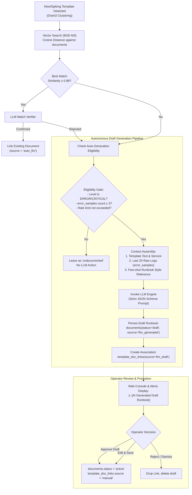

# Antigravity Proposal: Autonomous Runbook & Documentation Generation with Human-in-the-Loop Governance

**Document ID:** AGY-PROP-2026-001  
**Author:** Antigravity (AI Tech Lead / Architecture Pair)  
**Target Repository:** `logai2`  
**Status:** SUPERSEDED (2026-10-21) by the layered document matching in [`per-service-baseline.md`](per-service-baseline.md) sections 3 and 4a and plan [`2026-10-21-embeddings-doc-links.md`](../plans/2026-10-21-embeddings-doc-links.md): automatic corpus links on a separate ERROR field, LLM confirm-or-suggest (including SAFE documents) with human review. The design is authoritative where they differ.  
**Related Documents:**
- [`docs/design/per-service-baseline.md`](per-service-baseline.md) (Sections 3 & 4: Linking & Writing Documentation)
- [`docs/specs/2026-10-20-core-engine-design.md`](../specs/2026-10-20-core-engine-design.md) (Data Storage & Pipelines)

---

## 1. Executive Summary & Problem Statement

In the current baseline design ([`per-service-baseline.md`](per-service-baseline.md#L212-L216)), Runbook documentation creation is strictly interactive:
> *"The document editor gets an AI chat panel. Every LLM call here is started by the operator; nothing is drafted automatically."*

While this conservative policy prevents AI hallucinations, it introduces a significant operational bottleneck:
1. **Zero-Day Incident Blindspots:** When novel or rare critical error templates emerge during off-peak hours or major incidents, on-call SREs face an alert with `doc_id="undocumented"`. They have zero immediate guidance, diagnosis hints, or troubleshooting steps.
2. **Knowledge Backlog:** Engineering teams rarely have the time to manually write Runbooks for hundreds of newly discovered error templates, leaving the incident database perpetually incomplete.

### The Proposed Enhancement
Introduce an **Autonomous LLM Runbook Generator** coupled with **Human-in-the-Loop Governance**:
- When a novel, critical error template fails to match any existing Runbook via vector embedding (BGE-M3) and LLM verification, the system **automatically synthesizes a targeted operational Runbook draft**.
- The draft is grounded in real error samples, stack traces, and domain-specific context.
- The document is marked as `status = 'draft'` and linked as `source = 'llm_draft'`.
- SREs receive immediate guidance on active alerts, flagged with an AI disclaimer, and can promote the draft to production-ready (`status = 'active'`, `source = 'manual'`) with a single click or revision.

---

## 2. Core Architectural Principles

```
┌────────────────────────────────────────────────────────────────────────┐
│                   SRE INVIOLABILITY & SAFETY PRINCIPLES                │
├────────────────────────────────────────────────────────────────────────┤
│ 1. Autonomous Drafting, Controlled Promotion                           │
│    AI can propose drafts anytime; only verified humans promote them.   │
│                                                                        │
│ 2. Absolute Priority of Manual Operations                              │
│    MANUAL > INHERITED > AUTO_LLM > LLM_DRAFT > UNDOCUMENTED            │
│    Any manual assignment or approval permanently locks out AI edits.  │
│                                                                        │
│ 3. Grounded Context (Anti-Hallucination)                               │
│    No prompt runs on template string alone. Every LLM draft requires   │
│    real stack traces and raw lines from error_samples.                 │
└────────────────────────────────────────────────────────────────────────┘
```

---

## 3. End-to-End Processing Workflow



---

## 4. Trigger Criteria & Anti-Spam Filtering

To prevent runaway LLM costs and database clutter across 27,000+ templates:

| Filter Parameter | Threshold / Rule | Rationale |
| :--- | :--- | :--- |
| **Severity Filter** | `level IN ('ERROR', 'FATAL', 'CRITICAL')` OR Template triggers an active alert (baseline anomaly) | Never draft Runbooks for `INFO`, `DEBUG`, or routine operational noise. |
| **Novelty Distance** | Cosine similarity with existing Runbooks $< 0.85$ | Ensures we do not duplicate existing documentation. |
| **Evidence Floor** | $\ge 3$ raw log lines in `error_samples` table | Prevents the LLM from hallucinating on vague template patterns without real stack traces or error parameters. |
| **Rate Limiter / Cooldown** | Max 5 drafts per service per hour | Shields against cascading failure storms where dozens of new error templates might be generated simultaneously. |

---

## 5. Context Assembly & Prompt Engineering

### 5.1 Context Payload
The generation worker queries Postgres to assemble the following payload:
1. **Target Metadata:** `service`, `module_code`, `template_id`, `template_text`, `level`.
2. **Raw Evidence:** Up to 20 most recent lines from `error_samples` ordered by `at DESC`.
3. **Style Guide (Few-Shot Grounding):** One active, human-verified Runbook from the same service (if available) to mirror project conventions (internal tooling links, dashboard references, escalation contacts).

### 5.2 Structured Prompt
```text
System:
You are a Principal Site Reliability Engineer (SRE).
Analyze the provided log template and raw production stack traces, then generate a concise, actionable, production-ready operational troubleshooting Runbook in strict JSON.

Input Context:
Service: {{ service }}
Module: {{ module_code }}
Template: {{ template_text }}
Sample Raw Logs:
{{ raw_log_lines }}

Style Reference:
{{ style_reference_doc }}

JSON Output Requirements:
Respond ONLY with a valid JSON object adhering to this schema:
{
  "title": "Clear, business-oriented error summary (e.g., 'VNPay Gateway Connection Timeout')",
  "error_code": "Standardized uppercase code (e.g., 'VNPAY_TIMEOUT')",
  "hypothesis": "1-2 sentences explaining root cause based on stack traces and log details.",
  "impact": "Concrete business and customer impact.",
  "action_steps": [
    "Step 1: Check upstream network latency and firewall status...",
    "Step 2: Inspect connection pool saturation in Grafana...",
    "Step 3: If persistent, failover traffic or notify partner..."
  ],
  "verification_steps": "How to verify that the incident has been resolved.",
  "escalation": "Responsible team or on-call role to escalate if steps fail.",
  "confidence_score": 0.0 to 1.0
}
```

---

## 6. Database Schema Evolution

The proposed enhancement builds directly upon the existing PostgreSQL tables defined in `001_init.sql`:

```sql
-- Migration: Add status and governance attributes to documents
ALTER TABLE documents 
  ADD COLUMN IF NOT EXISTS status text NOT NULL DEFAULT 'active', -- 'draft', 'active', 'rejected'
  ADD COLUMN IF NOT EXISTS source text NOT NULL DEFAULT 'manual', -- 'manual', 'llm_generated'
  ADD COLUMN IF NOT EXISTS confidence_score real;

-- Index for fast retrieval of pending drafts
CREATE INDEX IF NOT EXISTS idx_documents_status ON documents (status) WHERE status = 'draft';

-- Note: template_doc_links already supports the 'source' column:
-- 'manual'         : Created or approved by SRE (Highest precedence, immutable)
-- 'auto_llm'       : Matched against existing Runbook by vector similarity + LLM
-- 'llm_draft'      : Linked to an automatically generated draft Runbook
```

---

## 7. Web UI & Operator Experience

### 7.1 Active Alerts Integration
When an alert triggers for a template linked to an `llm_draft` Runbook:
- The alert card displays an amber badge:
  > ⚠️ **AI Generated Draft (Unverified)** — *Verify commands before executing in production.*
- Action Buttons directly on the alert:
  - **[Approve & Promote]**: Instantly updates `documents.status = 'active'` and `template_doc_links.source = 'manual'`.
  - **[Edit in Runbook Editor]**: Opens the document in the markdown editor with the AI Chat assistant panel alongside.
  - **[Reject]**: Unlinks the draft and flags the template as `undocumented`.

### 7.2 Draft Review Queue
A dedicated view in the Web Console: **`Docs > AI Drafts Queue`**:
- Lists all pending generated Runbooks with their triggering template, occurrence rate, and sample logs.
- Allows bulk review or batch rejection by SRE leads.

---

## 8. Strategic Roadmap Alignment

| Phase | Milestone | Key Deliverables |
| :--- | :--- | :--- |
| **Current (Sub-project 1)** | Core Engine v1 Completion | Task 13 (Review loop), Task 14 (Docker, Compose, Incident Test). |
| **Sub-project 2** | Web Runbook Management | UI Editor, Document CRUD, AI Chat Sidecar Panel. |
| **Sub-project 3** | Vector Retrieval & Matching | BGE-M3 integration, pgvector embeddings, Match Verifier. |
| **Sub-project 4** | **Autonomous Draft Generator** | **Background Draft Worker, JSON Parser, Approval Queue UI.** |

---

*Authored by Antigravity — Approved for project roadmap consideration.*
